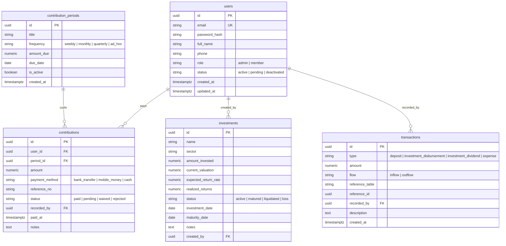

# Songothon (সংগঠন)
### Secure, Containerized Community Savings & Micro-Investment Management Platform

Songothon is an enterprise-grade financial management platform designed for collective savings clubs, cooperative societies, and micro-investment organizations. Members pool recurring contributions (weekly or monthly) into a unified reserve fund, and administrators deploy capital into diversified micro-investments while maintaining transparent real-time accounting and ledger auditability.

---

## 🏛️ System Architecture

The project follows **Domain-Driven Design (DDD)** and **Clean Architecture** principles across both the backend service and the mobile client.

```
                          ┌───────────────────────────┐
                          │   Flutter Mobile Client   │
                          │   (iOS & Android / BLoC)  │
                          └─────────────┬─────────────┘
                                        │ HTTPS / JWT
                                        ▼
┌─────────────────────────────────────────────────────────────────────────────┐
│                           Go Backend (Echo v4/v5)                           │
│                                                                             │
│  [ HTTP Handlers ] ──► [ Services (Business Logic) ] ──► [ Repositories ]   │
│         ▲                                                        │          │
│         │ RBAC Middleware                                        ▼          │
│  [ JWT Claims & Roles ]                                  [ PostgreSQL Pool ]│
└─────────────────────────────────────────────────────────────────────────────┘
```

### Backend Clean Architecture Layers:
1. **Domain Models (`backend/internal/domain/`)**: Pure domain entities, value objects, request/response DTOs, and role definitions (`RoleAdmin`, `RoleMember`).
2. **Repositories (`backend/internal/repository/postgres/`)**: Database access layer implemented via `jackc/pgx/v5` connection pooling. Handles atomicity, double-entry financial ledger records, and schema migrations.
3. **Services (`backend/internal/service/`)**: Business logic, password encryption (bcrypt), token issuance, payment processing, dues recalculation, and ROI computations.
4. **Handlers & Routing (`backend/internal/handler/`)**: Echo HTTP request handlers, validation, response formatting, and route groups.
5. **Middlewares (`backend/internal/middleware/`)**: JWT extraction and signature verification, context user identity mapping, and declarative RBAC enforcement (`RequireRole`).

---

## 📊 Database Schema Design

The relational PostgreSQL schema enforces referential integrity, status state machines, and double-entry transaction ledger tracking:



---

## 🔐 Role-Based Access Control (RBAC) Matrix

| Endpoint | Method | Access Level | Description |
|---|---|---|---|
| `/api/v1/auth/register` | POST | Public | Register new member |
| `/api/v1/auth/login` | POST | Public | Authenticate & retrieve JWT |
| `/api/v1/auth/me` | GET | Authenticated | Retrieve authenticated user profile |
| `/api/v1/reports/overview` | GET | Authenticated | View aggregate pool statistics (collected, invested, liquidity) |
| `/api/v1/contributions/periods` | GET | Authenticated | View scheduled savings deadlines & cycles |
| `/api/v1/contributions/my-history` | GET | Member | Personal deposit payment history |
| `/api/v1/contributions/my-dues` | GET | Member | Personal total contributed, pending dues, cycles |
| `/api/v1/investments` | GET | Authenticated | Portfolio asset listings (read-only for members) |
| `/api/v1/investments/:id` | GET | Authenticated | Specific investment breakdown & returns |
| `/api/v1/admin/members` | GET | **Admin Only** | List all club members with status filters |
| `/api/v1/admin/members/:id/status` | PATCH | **Admin Only** | Approve, activate, or deactivate members |
| `/api/v1/admin/members/:id/dues` | GET | **Admin Only** | Inspect individual member ledger and unpaid cycles |
| `/api/v1/admin/contributions/periods` | POST | **Admin Only** | Create new weekly/monthly contribution schedule |
| `/api/v1/admin/contributions/deposit` | POST | **Admin Only** | Record member payment & post to ledger |
| `/api/v1/admin/contributions` | GET | **Admin Only** | Full deposit audit log across organization |
| `/api/v1/admin/investments` | POST | **Admin Only** | Deploy pool capital to new investment asset |
| `/api/v1/admin/investments/:id` | PUT | **Admin Only** | Update valuations, dividends, or exit statuses |
| `/api/v1/admin/reports/financial-summary` | GET | **Admin Only** | Organization ledger and sector breakdowns |

---

## 📱 Flutter Mobile Architecture

Built using modern **Flutter 3** with the **Bloc / Cubit** state management pattern.

### Project Layout (`mobile/lib/`)
```
lib/
├── core/
│   ├── api/             # Dio client, automatic Bearer JWT injection & 401 interception
│   ├── storage/         # FlutterSecureStorage for encrypted token persistence
│   └── theme/           # Fintech design system (navy, emerald, slate)
├── models/              # Immutable Equatable models (User, Contribution, Investment, Metrics)
├── repositories/        # API repositories (AuthRepository, DashboardRepository, InvestmentRepository)
├── state/               # Cubits & States
│   ├── auth/            # AuthCubit: session restoration, login, logout, AuthGate
│   ├── dashboard/       # DashboardCubit: dues calculation, admin deposits, pool metrics
│   └── investment/      # InvestmentCubit: portfolio listings, sector filters, yields
└── screens/
    ├── auth/            # LoginScreen (with 1-tap demo credentials quick-filler)
    ├── admin/           # AdminDashboardScreen & RecordDepositDialog
    ├── member/          # MemberDashboardScreen (Personal Dues & History + Pool Overview)
    └── investment/      # InvestmentPortfolioScreen & InvestmentDetailScreen
```

### Key Screen Flows
1. **Login Flow (`LoginScreen`)**:
   - Clean, modern fintech authentication screen with instant 1-tap demo account fill buttons (`Admin`, `Member`).
2. **Member Dashboard (`MemberDashboardScreen`)**:
   - Personal Savings Hero card displaying total contributed amount and real-time pending dues alert.
   - Organization Overview card showing aggregate funds, capital deployed, and liquid reserves.
   - Complete itemized deposit history with payment channel indicators and transaction references.
3. **Admin Dashboard (`AdminDashboardScreen`)**:
   - Organization capital overview and active member counter.
   - Modal dialog for recording member deposits with automatic cycle and amount association.
   - Enrolled member roster with activation status chips.
4. **Investment Portfolio & Details (`InvestmentPortfolioScreen` & `InvestmentDetailScreen`)**:
   - Filterable by sector (Agriculture, Clean Tech, Real Estate, etc.).
   - Visual metrics: Invested Capital vs Current Valuation and Net Yield / ROI.
   - Comprehensive investment thesis, deployment dates, and maturity timeline.

---

## 🐳 Docker Deployment & Quick Start

### Prerequisites
- Docker Engine & Docker Compose
- Go 1.24+ (if running backend locally)
- Flutter SDK (if running mobile app locally)

### 1. Launch Backend API and PostgreSQL with Docker Compose
```bash
# Clone the repository and navigate to root
cd songothon

# Start PostgreSQL and Go API in containerized mode
docker compose up -d --build
```

The database schema and seed data are automatically applied on container initialization.

- Backend Healthcheck: `http://localhost:8080/health`
- API Base URL: `http://localhost:8080/api/v1`

### 2. Default Seed Credentials

| Role | Email | Password |
|---|---|---|
| **Admin** | `admin@songothon.org` | `Password123!` |
| **Member (Alice)** | `alice@songothon.org` | `Password123!` |
| **Member (Bob)** | `bob@songothon.org` | `Password123!` |

### 3. Run Mobile App (Flutter)
```bash
cd mobile

# Run unit and widget tests
flutter test

# Run app on simulator/emulator or desktop
flutter run
```

*Note for Android Emulator*: The mobile client automatically detects Android emulators and routes requests to host loopback `http://10.0.2.2:8080/api/v1`.
